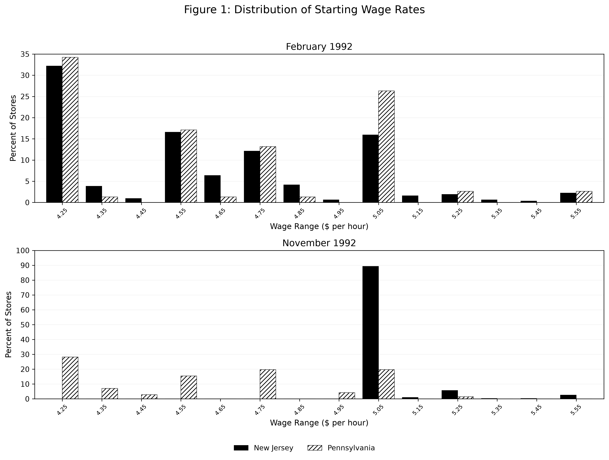
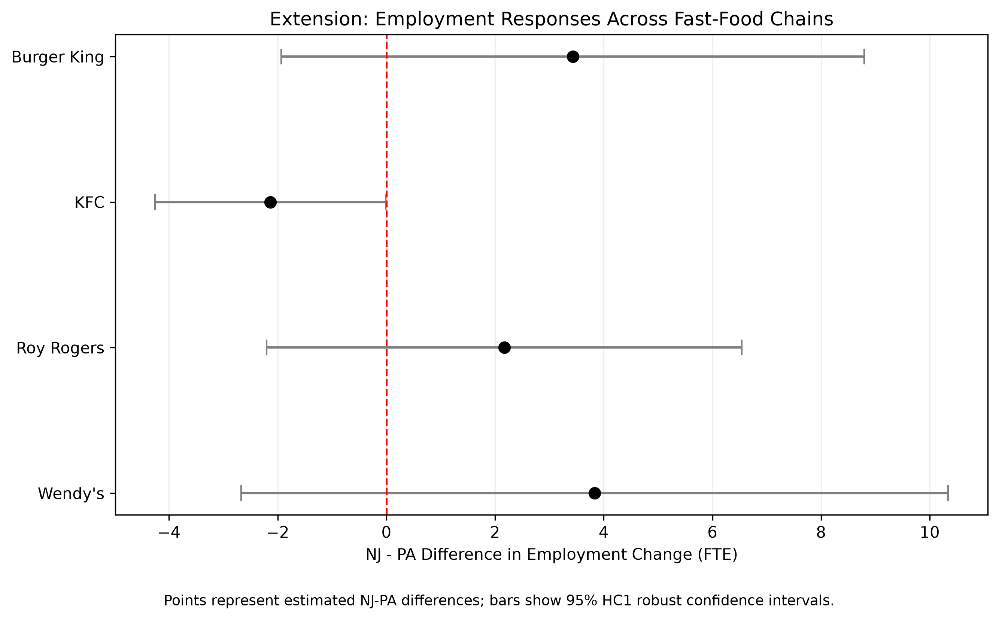

**ECON6067 Individual Project**

# Replication of Card and Krueger (1994): Minimum Wages and Employment

## 1. Introduction

### 1.1 Research Question and Motivation

The effect of the minimum wage on employment is a central question in labour economics. In the standard competitive labour-market model, a higher minimum wage raises firms' labour costs and is therefore predicted to reduce employment. However, some empirical studies find no clear negative employment effect, which calls this traditional prediction into question.

Card and Krueger (1994) study this question with a natural experiment. In April 1992, New Jersey raised its minimum wage from \$4.25 to \$5.05 per hour, while neighbouring Pennsylvania left its minimum wage unchanged. The authors use a difference-in-differences (DID) design to compare the employment changes of fast-food restaurants in the two states before and after the policy change.

### 1.2 Replication Objectives

This project uses Python to reproduce the paper's Table 2–4 and Figure 1, and compares the results with the original. In addition, it carries out an independent extension that tests whether the employment change associated with the minimum-wage increase differs across four fast-food chains — Burger King, KFC, Roy Rogers, and Wendy's. The objectives are to verify the paper's main findings and to establish a transparent, reproducible empirical workflow.

## 2. Data Sources, Sample Construction, and Variable Definitions

### 2.1 Data Source

The data contain 410 fast-food restaurants, of which 331 are located in New Jersey and 79 in Pennsylvania. The two surveys were conducted in February 1992 (before the minimum-wage increase) and November 1992 (after the increase).

### 2.2 Sample Construction

The raw data contain 410 restaurants. Under the replication's balanced-sample definition, 384 restaurants have usable employment observations in both survey waves. For Table 4, the sample is further restricted to stores with a valid employment change, a valid starting wage, a valid Wave-2 wage or a permanent closure, and no missing control variables. This yields 357 restaurants, matching the sample size reported in the original paper. The independent extension uses this same 357-restaurant sample, and its robustness check excludes the six permanently closed restaurants, leaving 351.

### 2.3 Variable Definitions

The main dependent variable is full-time-equivalent (FTE) employment:

$$
FTE_{it} = EMPFT_{it} + NMGRS_{it} + 0.5\,EMPPT_{it}
$$

where $EMPFT$ is the number of full-time employees, $NMGRS$ is the number of managers, and $EMPPT$ is the number of part-time employees, who are counted as half of a full-time worker. The employment change is defined as:

$$
\Delta FTE_i = FTE_{i,2} - FTE_{i,1}
$$

New Jersey is the treatment group (`STATE = 1`) and Pennsylvania the control group (`STATE = 0`). For Table 4, the initial wage gap measures how much a restaurant's starting wage would have to rise, in proportional terms, to reach the new minimum wage of \$5.05, using the pre-policy starting wage as the denominator. The wage gap is set to zero for Pennsylvania restaurants.

### 2.4 Data Cleaning and Closure Treatment

Following the replication rules, the six restaurants that permanently closed by the second survey (`STATUS2 = 3`) are assigned a Wave-2 employment of zero, while the four temporarily closed restaurants (`STATUS2 = 2, 4, 5`) are treated as missing. Table 3 also considers an alternative specification in which temporarily closed restaurants are assigned a Wave-2 employment of zero. The robustness check of the independent extension excludes the permanently closed restaurants. These choices must be stated explicitly, because sample construction and the treatment of closures affect the estimated employment change.

## 3. Empirical Design

This study follows the difference-in-differences (DID) design of Card and Krueger (1994). New Jersey is the treatment group, whose minimum wage rose from \$4.25 to \$5.05 per hour in April 1992; Pennsylvania is the control group, whose minimum wage remained unchanged. The DID estimator measures the policy effect by comparing the change in FTE employment in the two states:

$$
DID = (FTE_{NJ,\text{after}} - FTE_{NJ,\text{before}}) - (FTE_{PA,\text{after}} - FTE_{PA,\text{before}})
$$

The study also estimates OLS regressions of the employment change, using either the New Jersey dummy or the initial wage gap as the main explanatory variable, together with controls for chain, ownership, and region.

The causal interpretation of the DID estimates relies on the parallel-trends assumption: in the absence of the minimum-wage increase, employment in New Jersey and Pennsylvania would have followed similar trends. Because the data contain only one pre-policy survey, this assumption cannot be tested directly.

## 4. Core Replication Results and Comparison with the Original Paper

### 4.1 Table 2: Descriptive Statistics

Table 2 reports the basic characteristics of New Jersey (NJ) and Pennsylvania (PA) fast-food restaurants before and after the increase. The replication reproduces most of the paper's descriptive statistics, including restaurant characteristics, FTE employment, starting wages, meal prices, and hours of operation.

**Table 2. Descriptive Statistics**

**Panel A: Store composition (% of stores)**

| | New Jersey | Pennsylvania |
|---|---|---|
| Burger King | 41.09 | 44.30 |
| KFC | 20.54 | 15.19 |
| Roy Rogers | 24.77 | 21.52 |
| Wendy's | 13.60 | 18.99 |
| Company-owned | 34.14 | 35.44 |

*Note:* Panel A is based on 331 New Jersey and 79 Pennsylvania stores.

**Panel B: Wave 1 (February 1992), mean (standard error)**

| Variable | New Jersey | Pennsylvania |
|---|---|---|
| FTE employment | 20.44 (0.51) | 23.33 (1.35) |
| Percentage full-time employees† | 28.63 (1.28) | 30.29 (2.67) |
| Starting wage (\$) | 4.61 (0.02) | 4.63 (0.04) |
| Wage = \$4.25 (%) | 30.51 (2.53) | 32.91 (5.32) |
| Price of full meal (\$) | 3.35 (0.04) | 3.04 (0.07) |
| Hours open (weekday) | 14.42 (0.15) | 14.53 (0.33) |
| Recruiting bonus (%) | 23.56 (2.34) | 29.11 (5.14) |

**Panel C: Wave 2 (November 1992), mean (standard error)**

| Variable | New Jersey | Pennsylvania |
|---|---|---|
| FTE employment | 21.03 (0.52) | 21.17 (0.94) |
| Percentage full-time employees† | 32.01 (1.41) | 26.02 (2.77) |
| Starting wage (\$) | 5.08 (0.01) | 4.62 (0.04) |
| Wage = \$4.25 (%) | 0.00 | 25.32 (4.92) |
| Wage = \$5.05 (%) | 85.50 (1.94) | 1.27 (1.27) |
| Price of full meal (\$) | 3.41 (0.04) | 3.03 (0.07) |
| Hours open (weekday) | 14.42 (0.15) | 14.65 (0.33) |
| Special recruiting program (proxy)‡ | 20.32 (2.27) | 23.38 (4.85) |

† The full-time-employee percentage uses an alternative definition that excludes managers. ‡ The Wave-2 recruiting measure uses `SPECIAL2` as a proxy and is not equivalent to the paper's cash recruiting bonus.

Before the increase, average FTE employment was 20.44 in New Jersey and 23.33 in Pennsylvania; after the increase the corresponding figures were 21.03 and 21.17. Average starting wages were about \$4.61 and \$4.63 per hour in the two states before the increase; afterwards New Jersey's rose to \$5.08 while Pennsylvania's remained at about \$4.62.

Some variables are reproduced with differences from the original. First, the full-time-employee percentage computed here excludes managers, which differs from the paper's definition. Second, the Wave-2 recruiting measure uses `SPECIAL2` as a proxy. Although the replicated proportions (20.32% for New Jersey and 23.38% for Pennsylvania) are very close to the paper's 20.3% and 23.4%, this variable does not necessarily measure the same recruiting incentive, so it cannot be treated as a fully identical replication.

### 4.2 Figure 1: Distribution of Starting Wages

Figure 1 compares the distribution of starting wages in New Jersey and Pennsylvania before and after the increase. The replication uses 10-cent wage bins, with percentages computed from the number of restaurants with a valid starting wage in each state and survey period.

**Figure 1. Distribution of Starting Wages.** Starting wages in 10-cent bins, separately by state and survey wave. Source: `outputs/figures/figure1_replication.png`.

In February 1992, starting wages in both states were concentrated near \$4.25 per hour: 32.17% of New Jersey and 34.21% of Pennsylvania restaurants fell in that bin. After the increase, the New Jersey distribution shifted clearly toward \$5.05. By November 1992, 89.31% (284/318) of New Jersey's valid wage observations were in the bin centred at \$5.05, compared with only 15.92% before the increase. At the same time, the share of New Jersey restaurants in the \$4.25 bin fell to 0%.

In contrast, Pennsylvania's distribution changed little. The share in the \$4.25 bin fell from 34.21% to 28.17%, and the share in the \$5.05 bin changed from 26.32% to 19.72%.

Overall, the replicated figure follows the same main pattern as the original: after the increase, New Jersey's starting-wage distribution shifted upward while Pennsylvania's remained relatively stable. This indicates that the policy change is closely associated with a rise in New Jersey starting wages, although the wage distribution alone cannot tell us how employment responded.

One clarification is worth making: the figure uses 10-cent *bins*, so a share such as 89.31% refers to all wages in the \$5.00–\$5.10 range, not only wages exactly equal to \$5.05. The percentages also use a different denominator from Table 2 — they are shares of stores with a valid starting wage in the relevant state and wave (for example, 318 valid observations in New Jersey in November 1992), whereas Table 2's "wage = \$4.25" and "wage = \$5.05" rows use all stores as the denominator. These two definitions therefore do not have to coincide.

### 4.3 Table 3: Employment Changes

Table 3 compares the change in full-time-equivalent (FTE) employment in New Jersey (NJ) and Pennsylvania (PA) before and after the minimum-wage increase. The replication closely reproduces the main results reported by Card and Krueger (1994).

**Table 3. Employment Changes**

**Panel A: Employment Changes in New Jersey and Pennsylvania**

| Measure | PA | NJ | NJ − PA |
|:---|---:|---:|---:|
| FTE before | 23.33 | 20.44 | −2.89 |
| FTE after | 21.17 | 21.03 | −0.14 |
| Change in mean FTE | −2.17 | 0.59 | **2.75** |
| Balanced-sample change | −2.28 | 0.47 | **2.75** |
| Temporary closures = 0 | −2.28 | 0.23 | **2.51** |

**Panel B: Employment Changes by Initial Wage Group in New Jersey**

| Measure | Low | Midrange | High | Low − High | Mid − High |
|:---|---:|---:|---:|---:|---:|
| FTE before | 19.56 | 20.08 | 22.25 | −2.69 | −2.17 |
| FTE after | 20.88 | 20.96 | 20.21 | 0.66 | 0.74 |
| Change in mean FTE | 1.32 | 0.87 | −2.04 | 3.36 | 2.91 |
| Balanced-sample change | 1.20 | 0.71 | −2.16 | 3.36 | 2.87 |
| Temporary closures = 0 | 0.90 | 0.49 | −2.39 | 3.29 | 2.88 |

*Notes:* Panel A compares FTE employment between New Jersey and Pennsylvania. The NJ − PA column reports the difference between the two states, with the employment-change rows representing the difference-in-differences (DID) estimates. Panel B divides New Jersey restaurants into low-, midrange-, and high-wage groups based on their pre-policy starting wages. The balanced-sample specification includes restaurants with valid employment observations in both survey waves, while the temporary-closure specification assigns zero Wave-2 employment to temporarily closed restaurants.

Sample sizes (PA / NJ; Low / Midrange / High): FTE before 77 / 321 (97 / 137 / 71); FTE after 77 / 319 (98 / 135 / 69); balanced-sample change 75 / 309 (94 / 132 / 67); temporary closures = 0: 75 / 313 (95 / 134 / 68).

Before the minimum-wage increase, average FTE employment was 20.44 in New Jersey and 23.33 in Pennsylvania. After the increase, the corresponding figures were 21.03 and 21.17. New Jersey's average employment increased by approximately 0.59 FTE, while Pennsylvania's decreased by approximately 2.17 FTE. The resulting DID estimate is 2.754 FTE, very close to the original paper's reported value of 2.76.

The results remain similar under alternative sample treatments. The balanced-sample DID estimate is 2.750 FTE, matching the original paper, while assigning zero employment to temporarily closed restaurants produces an estimate of 2.509 FTE, close to the paper's 2.51.

Within New Jersey, employment increased by approximately 1.32 and 0.87 FTE in low- and midrange-wage restaurants, respectively, while high-wage restaurants experienced a decrease of approximately 2.04 FTE. These findings are consistent with the employment patterns reported in the original paper.

Overall, the replication closely reproduces the main employment changes and DID estimates in Table 3. However, some standard errors are calculated approximately without fully accounting for within-store covariance across the two survey waves. Therefore, not all statistical measures are exactly replicated.

### 4.4 Table 4: Reduced-Form Regression Results

Table 4 reports five ordinary least squares (OLS) regressions of the FTE employment change. The models use the New Jersey dummy or the initial wage gap as the main explanatory variable, and add controls for chain, ownership, and region step by step.

The replication uses 357 restaurants, matching the paper's sample size. The mean and standard deviation of the employment change are −0.2375 and 8.8255, close to the paper's reported −0.237 and 8.825.

**Table 4. Reduced-Form Regression Results**

| Independent variable | (i) | (ii) | (iii) | (iv) | (v) |
|---|---|---|---|---|---|
| New Jersey dummy | 2.33 | 2.30 | — | — | — |
| 　(standard error) | (1.19) | (1.20) | — | — | — |
| Initial wage gap | — | — | 15.65 | 14.92 | 11.98 |
| 　(standard error) | — | — | (6.08) | (6.21) | (7.42) |
| Controls: chain and ownership | no | yes | no | yes | yes |
| Controls: region | no | no | no | no | yes |
| Standard error of regression | 8.79 | 8.78 | 8.76 | 8.76 | 8.75 |
| p-value for controls | — | 0.34 | — | 0.44 | 0.40 |

The coefficients on the New Jersey dummy in models (i) and (ii) are 2.33 and 2.30; the coefficients on the initial wage gap in models (iii) and (iv) are 15.65 and 14.92 — all matching the original paper to two decimal places. In model (v), which adds regional controls, the replicated coefficient is 11.98 versus the paper's 11.91; the corresponding standard errors are 7.42 and 7.39. The standard error of the regression and the p-value of the joint F-test on the controls are also close to the paper's.

**Table 4 (comparison). Coefficient comparison: original vs replication**

| Model | Variable | Original | Replication |
|---|---|---|---|
| (i) | New Jersey dummy | 2.33 | 2.33 |
| (ii) | New Jersey dummy | 2.30 | 2.30 |
| (iii) | Initial wage gap | 15.65 | 15.65 |
| (iv) | Initial wage gap | 14.92 | 14.92 |
| (v) | Initial wage gap | 11.91 | 11.98 |

Overall, the replication reproduces the main Table 4 results closely, with only a small difference in model (v). The main coefficients are positive in all models, consistent with the paper's finding of no employment decline in New Jersey relative to Pennsylvania. However, a positive coefficient does not by itself imply a statistically significant positive employment effect; the causal interpretation still depends on the DID identifying assumptions.

## 5. Independent Extension

### 5.1 Research Question and Motivation

Card and Krueger (1994) compare fast-food restaurants in New Jersey and Pennsylvania to study the employment effect of the minimum-wage increase. Their regression controls for chain and ownership characteristics, but does not explicitly test whether the employment response differs across chains.

This extension therefore asks whether the employment change differs across the four main chains — Burger King, KFC, Roy Rogers, and Wendy's. Chains may differ in their operating structure, pricing strategy, and labour demand, so they may adjust employment differently when labour costs rise. Examining chain-level heterogeneity offers another way to understand the paper's findings.

### 5.2 Empirical Method

The extension uses the same 357-restaurant sample as the Table 4 replication. The dependent variable is the change in FTE employment between the two surveys. The model is an OLS regression with chain dummies and their interactions with the New Jersey dummy:

$$
\Delta FTE_i = \beta_0 + \beta_1 NJ_i + \sum_{k=2}^{4} \gamma_k Chain_{ki} + \sum_{k=2}^{4} \delta_k (NJ_i \times Chain_{ki}) + \varepsilon_i
$$

Burger King is the reference group. The coefficient on the New Jersey dummy ($\beta_1$) is Burger King's NJ–PA employment-change difference, and the interaction coefficients ($\delta_k$) measure how much the other chains differ from Burger King. The model uses HC1 heteroskedasticity-robust standard errors, and a joint Wald F-test is used to test whether the three interaction coefficients are simultaneously zero:

$$
H_0:\ \delta_{KFC} = \delta_{ROY} = \delta_{WENDYS} = 0
$$

Rejecting this null hypothesis would provide statistical evidence that the NJ–PA employment-change difference varies across chains.

### 5.3 Results and Interpretation

The estimated NJ–PA employment-change differences vary across the four chains.

**Extension Table 1. Chain-Specific Employment Differences**

| Chain | NJ − PA (FTE) | Robust SE | p-value | 95% CI |
|---|---|---|---|---|
| Burger King | 3.431 | 2.737 | 0.210 | [−1.934, 8.795] |
| KFC | −2.134 | 1.083 | 0.049 | [−4.256, −0.013] |
| Roy Rogers | 2.168 | 2.232 | 0.331 | [−2.207, 6.544] |
| Wendy's | 3.832 | 3.320 | 0.248 | [−2.674, 10.339] |

**Extension Figure 1. Chain-Specific Employment Effects.** Point estimates and 95% robust confidence intervals for each chain's NJ−PA difference in the change in FTE employment. Source: `outputs/figures/extension_chain_effects.png`.

Burger King, Roy Rogers, and Wendy's have estimated differences of +3.431, +2.168, and +3.832 FTE respectively, while KFC's estimate is −2.134 FTE.

KFC's *own* NJ–PA employment-change difference is significant at the 5% level (p = 0.0487, without multiple-comparison adjustment). This does **not**, however, mean that KFC differs significantly from Burger King: the NJ × KFC interaction term has a p-value of 0.059 and is not significant at the 5% level. These two tests have different null hypotheses and should not be conflated.

The joint Wald F-test gives F = 2.4902 with p = 0.0601. At the 5% level we therefore cannot reject the hypothesis that the NJ–PA employment-change difference is the same across chains, but at the 10% level the null is rejected. The extension figure shows the four estimates together with their 95% robust confidence intervals.

### 5.4 Discussion and Limitations

The results suggest that the employment response may differ across chains. These differences could be related to differences in operating structure, labour demand, or employment-adjustment strategies, but this extension does not test those mechanisms directly.

Although KFC's own NJ–PA difference is significant at the 5% level, both the NJ × KFC interaction term and the joint heterogeneity test are insignificant at that level. There is therefore no strong evidence of an overall, systematic difference in the employment response across chains.

The extension has several limitations. First, some chains have small Pennsylvania samples, especially KFC and Wendy's, which may reduce precision. Second, multiple comparisons increase the chance of finding an individually significant result by accident. Third, interpreting the NJ–PA differences as causal effects of the minimum-wage policy requires the parallel-trends and other identifying assumptions, which cannot be tested with only one pre-policy survey.

Overall, the extension provides preliminary evidence of chain heterogeneity at the 10% level, but this should be interpreted cautiously given the estimation uncertainty and the identifying limitations.

### 5.5 Robustness Check

To check whether the permanently closed restaurants drive the results, the extension re-estimates the baseline model after excluding the six permanently closed restaurants. The sample falls from 357 to 351, while the model specification and HC1 robust standard errors remain unchanged.

After re-estimation, the interaction coefficients are broadly similar to the baseline. For example, NJ × KFC changes from −5.565 to −5.871, and NJ × Roy Rogers changes from −1.263 to −2.279.

**Extension Table 2. Robustness Check**

| Coefficient / test | Baseline (N = 357) | Robustness (N = 351) |
|---|---|---|
| STATE (Burger King gap) | 3.431 | 3.737 |
| NJ × KFC | −5.565 | −5.871 |
| NJ × Roy Rogers | −1.263 | −2.279 |
| NJ × Wendy's | 0.401 | 0.096 |
| Joint Wald F-statistic | 2.4902 | 2.4087 |
| Joint p-value | 0.0601 | 0.0669 |

The joint Wald F-test gives F = 2.4087 with p = 0.0669, compared with the baseline F = 2.4902 and p = 0.0601. Neither model rejects the hypothesis of equal NJ–PA employment-change differences across chains at the 5% level, but both reject it at the 10% level.

Overall, excluding the permanently closed restaurants does not change the main statistical conclusion, which suggests that the result is somewhat robust to this sample choice. However, this check does not establish robustness to other model specifications or data treatments.

## 6. Validation, Limitations and Conclusion

### 6.1 Validation

This project validates the replication by comparing the reproduced statistics with those reported in Card and Krueger (1994). Tables 2 and 3 reproduce the paper's descriptive statistics and employment-change patterns well, and Figure 1 shows the clear upward shift of New Jersey's starting-wage distribution. For Table 4, the main coefficients of models (i)–(iv) match the paper to two decimal places, with only a small difference in model (v). In addition, the Python script generates all of the main tables and figures through a single, reproducible workflow. A separate document (`AI_USE_DISCLOSURE.md`) records how AI tools were used, checked, and corrected in this project.

### 6.2 Limitations

The replication has several limitations.

First, some variables in Table 2 use alternative definitions, in particular the full-time-employee percentage and the Wave-2 recruiting measure.

Second, some Table 3 standard errors are computed approximately, without fully accounting for the covariance between the two surveys within the same restaurant.

Third, although the Table 4 sample size matches the paper, this does not guarantee that the sample is constructed identically, and model (v) still shows a small numerical difference.

In addition, the DID method relies on the parallel-trends and related identifying assumptions, which cannot be tested directly with only one pre-policy survey. The independent extension is also limited by small sample sizes for some chains and by multiple comparisons.

### 6.3 Conclusion

Overall, this project reproduces the main findings of Card and Krueger (1994) well. The results show that after the minimum-wage increase, starting wages in New Jersey rose clearly, but there is no evidence of a relative decline in employment compared with Pennsylvania.

The independent extension finds that the employment response may differ across chains: there is some evidence of chain heterogeneity at the 10% level, but it is not significant at the 5% level. Excluding the permanently closed restaurants leaves this main conclusion unchanged.

Despite some remaining replication differences and limitations, this project shows that the paper's main empirical results can be reproduced through a transparent and reproducible Python workflow.

## 7. References

Card, David, and Alan B. Krueger. 1994. "Minimum Wages and Employment: A Case Study of the Fast-Food Industry in New Jersey and Pennsylvania." *American Economic Review* 84(4): 772–793.

